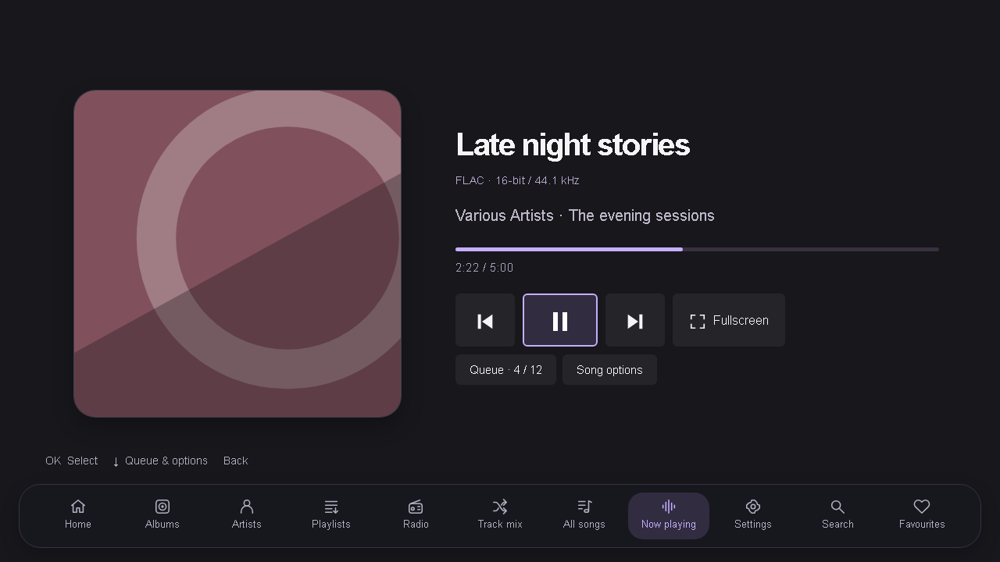
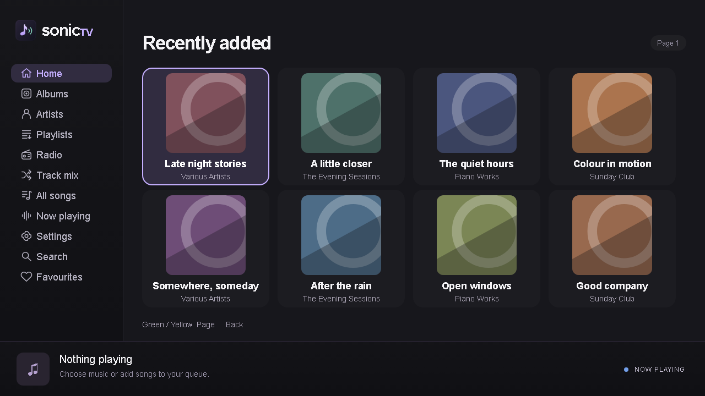
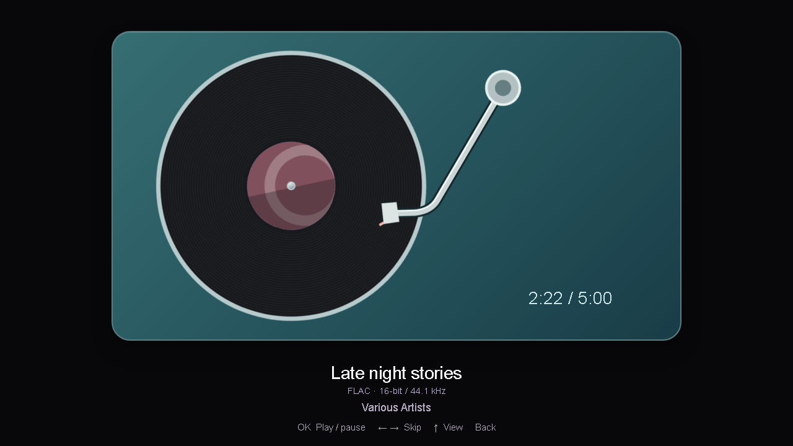
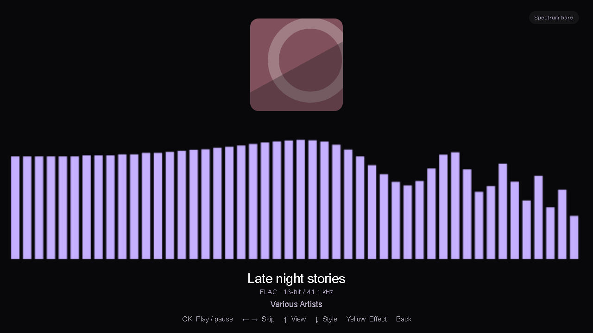

# SubsonicTV

A lightweight Navidrome / Subsonic music player for older Samsung Tizen TVs. Built with plain ES5 JavaScript, HTML and CSS, designed around the remote, and tested on Tizen 2.4 hardware.

Created by **Dramak**. Current widget version: **0.15.3**.



## Features

- Albums, artists, playlists, all songs, search, server favourites and configured internet radio.
- A–Z filters, album shuffle, full-library shuffle and three Track Mix modes: weighted discovery, random songs, or a selected genre.
- Now Playing seed mixes: track recommendations, album genres and artist-only shuffle, without restarting the current song.
- Editable queue with Play next, Add to queue, reorder and remove; repeat one/all and paused session restore.
- Classic, Lounge bottom-dock and Midnight layouts, with adjustable colours.
- Fullscreen cover art, ambient motion, seven reactive visualizers, and a spinning LP whose tonearm follows track progress.
- Original MP3/FLAC streaming through an incremental decoder, plus TV playback for other formats. Optional server transcoding, play/pause fades and ReplayGain attenuation.
- Configurable idle fullscreen and foreground screensaver suppression.

## Screenshots

These are desktop renders of the actual interface with fictional album data and generated sample artwork. The spectrum screenshot uses synthetic values to demonstrate the layout. They contain no personal library data and are not photographs of a TV.

| Library | Spinning LP |
| --- | --- |
|  |  |



## Requirements

- A Samsung Tizen TV with Developer Mode available, and a Navidrome or compatible Subsonic server reachable from the TV.
- [Tizen Studio and the Samsung TV tools](https://developer.samsung.com/smarttv/develop/getting-started/setting-up-sdk.html), including the Samsung Certificate Extension.
- A signing profile appropriate for your target TV. Follow Samsung’s [certificate instructions](https://developer.samsung.com/smarttv/develop/getting-started/setting-up-sdk/creating-certificates.html), including device registration where required.
- PowerShell for the supplied build script. Node.js 18+ is needed only for tests and screenshot previews, not for packaging or playback. No npm install is needed.

The manifest declares Tizen 2.3 as its minimum. Actual device testing has focused on Tizen 2.4; that declaration is not a guarantee for every older firmware. Codec and TLS support vary by TV.

## Build the WGT

Clone the repository and run commands from its root:

```powershell
git clone https://github.com/drogog/subsonictv.git
cd subsonictv

# Set this to your own Tizen Studio installation and signing profile.
$tizenCli = 'C:\tizen-studio\tools\ide\bin\tizen.bat'
.\scripts\build.ps1 -Profile 'YourSigningProfile' -TizenCli $tizenCli
```

If Tizen CLI is on your PATH, `-TizenCli` can be omitted. The script copies the widget into `.build/widget`, signs it, and writes **`dist/SubsonicTV.wgt`**. It always replaces the staged server configuration with the blank example; developer credentials from `subsonic-tv/js/config.js` are never shipped by this script. Signing uses your existing Tizen profile, not a certificate committed to this repository.

For manual packaging, create a blank config first and make sure no old `.wgt` remains inside the source directory:

```powershell
Copy-Item .\subsonic-tv\js\config.example.js .\subsonic-tv\js\config.js
Remove-Item .\subsonic-tv\SubsonicTV.wgt -ErrorAction SilentlyContinue
& $tizenCli package -t wgt -s 'YourSigningProfile' -- .\subsonic-tv
```

The manual command writes into `subsonic-tv`; use that path instead of `dist` when installing. Prefer the supplied build script for repeatable, credential-free packages. Samsung documents the underlying commands in its [CLI guide](https://developer.samsung.com/smarttv/develop/getting-started/using-sdk/command-line-interface.html).

## Install on the TV

1. Follow Samsung’s [TV connection guide](https://developer.samsung.com/smarttv/develop/getting-started/using-sdk/tv-device.html): enable Developer Mode, set the development computer’s address, and restart the TV when prompted.
2. Connect from the same reachable network. Replace the placeholders below with your TV address and the target name reported by `sdb devices`.
3. In Tizen Device Manager, use **Permit to install applications** if required by your device/profile.

```powershell
$sdb = 'C:\tizen-studio\tools\sdb.exe'
$tvAddress = 'YOUR_TV_IP:26101'
& $sdb connect $tvAddress
& $sdb devices

$targetName = 'YOUR_TARGET_NAME'
& $tizenCli install -n .\dist\SubsonicTV.wgt -t $targetName
& $tizenCli run -p SubsonicTV.SubsonicTV -t $targetName
```

Use the same app identity and author certificate for updates. An installation rejected for certificate mismatch needs the original signing identity or a deliberate uninstall/reinstall; uninstalling can clear TV-local settings.

On first launch, open **Settings → Server setup**. Enter **Address** (hostname/IP and optional `/base/path`), a separate **Port**, **SSL** on for HTTPS or off for HTTP, then username and password. Choose **Save and connect**. A blank port uses 443 with SSL or 80 without it. Pasting a complete URL also fills the port and SSL fields. The address must be reachable from the TV; `localhost` would refer to the TV itself. The app saves a Subsonic token and salt, not the plaintext password. These are still reusable credentials stored on the TV. No account or device details are included in this repository.

Under **Server setup → Saved servers**, OK tests and connects to a profile; Yellow edits it. **Add server** creates a separate login (up to eight). Switching restarts the app after a successful test, keeping playback and the active server unchanged on failure or cancellation. Existing single-server settings migrate automatically. Remove an inactive profile from its edit screen; switch away before removing the active one. Saved tokens are never reused automatically for a changed address or username.

## Remote controls

| Screen | Controls |
| --- | --- |
| Library | Arrows browse; OK opens/plays; Back returns; Green/Yellow pages; Blue opens Now Playing. |
| Albums / artists | Up from the first row opens A–Z. Left/Right chooses a letter, OK filters. |
| Song list | Up from the first row selects Shuffle. Red opens song options. |
| Now Playing | Left/Right selects a control, OK activates; Down opens the queue/options row. |
| Lounge dock | Left/Right chooses a section; OK opens; Up returns to content. Down from the lower player controls enters the dock. |
| Queue | Up/Down selects; Left/Right moves; Green plays; Yellow removes; OK opens actions. |
| Fullscreen | OK play/pause; Left/Right skips; Up changes view; Down changes visualizer style; Yellow changes effect; Back exits. |
| Search | Remote keyboard or physical keyboard; Green submits the query. |

Media play/pause/stop and next/previous keys are also supported. TV volume stays under the TV’s control. Red opens diagnostics outside song-list/Now Playing contexts.

## Settings and limitations

- **Default fullscreen** chooses Cover, Ambient, Music visualization or Spinning LP. Switching with Up is temporary; reopening uses the saved default.
- **Listening preferences** includes idle fullscreen (Off / 30 / 60 / 120 / 300 seconds), repeat, queue restore, and Track/Album ReplayGain. Album mode falls back to track tags. Normalization attenuates only, uses available peak metadata and never boosts above source volume. Missing tags remain unchanged; it does not scan files for loudness.
- **Visualization settings** includes Spectrum bars, Mirror spectrum, Waveform, Orbit, Ribbon, Halo and Dot matrix. Effects are Clean, Soft trails, Bass pulse, Colour flow and Zoom pulse. Soft trails use a fixed short geometry history over a fresh opaque background, preventing permanent fade residue. Sensitivity, red saturation tips (bars/Orbit) and Keep screen awake are also available. Red tips indicate the visualizer’s display ceiling, not measured audio distortion. Screensaver suppression applies while the app is visible and does not override a TV sleep timer.
- **Reactive playback** requires original MP3/FLAC and HTTP byte-range support. The custom decoder keeps a small buffer ahead rather than downloading the whole track. Other codecs, radio and requested transcodes use the TV media path, where reactive visualization may be unavailable. A failed decoder falls back to TV playback where possible.
- **Now Playing mixes:** open **Song options → Start mix** (or press Red on Now Playing). Track mix tries server recommendations, then genre tags or the artist’s library; Album mix uses the album’s genres, falling back to artist recommendations/library; Artist mix shuffles only songs identified as belonging to the current artist. The current song continues while up to 50 upcoming songs replace the old upcoming queue. Queue shows the seed and method used. Back cancels loading; unavailable album/artist IDs disable those choices. Artist sampling is limited to eight albums.
- **Session restore** saves up to 500 nearby queue entries as metadata only. It opens paused; Play restarts the selected song from the beginning. Arbitrary seeking and gapless/crossfade playback are not implemented. Play/pause fade is available.
- **All Songs shuffle** scans library metadata before starting; Back cancels. Browsing stays paged. No audio or cover collection is downloaded for this scan.
- **Radio** needs a direct HTTP(S) audio URL configured in the server. Playlist URLs and in-stream song metadata are not parsed.
- **Playlist creation/editing** remains in the server UI. Full-library search requires a server that accepts an empty `search3` query, as Navidrome does.

## Development

```powershell
node scripts/test.cjs
node tests/preview.cjs
# Open .preview/index.html in a browser.
```

The test runner executes 21 offline checks using Node’s built-in modules. Preview fragments include `#dock`, `#player`, `#lp`, `#viz0` through `#viz6`, `#settings`, `#search`, `#queue` and `#midnight`. Preview data is fictional; it makes no requests to a real music server.

Optional `tests/live-*.cjs` checks require a locally configured, ignored `subsonic-tv/js/config.js`; they are not part of the offline suite. Keep credentials, signed packages and signing certificates out of commits. Device-only decoder testing is available in **Settings → Audio quality → Streaming decoder test**.

See [architecture and storage](docs/architecture.md) for implementation details and [screenshot generation](docs/screenshots.md) to reproduce the images.

See [Now Playing mixes](docs/roadmap.md) for behaviour, fallback rules and remaining device checks.

## Libraries and attribution

| Component | Version / origin | License | Used for |
| --- | --- | --- | --- |
| [Aurora.js](https://github.com/audiocogs/aurora.js/releases/tag/v0.4.4) | Audiocogs 0.4.4 | MIT | Demuxing and decoder framework |
| [MP3.js](https://github.com/audiocogs/mp3.js/releases/tag/v0.1.0) | Audiocogs 0.1.0; derived from JSMad | GPL-2.0 | Incremental MP3 decoding |
| [FLAC.js](https://github.com/audiocogs/flac.js/releases/tag/v0.2.1) | Audiocogs 0.2.1; decoder derived from FFmpeg | LGPL-2.1-or-later | Incremental FLAC decoding |

The readable browser bundles and their license texts are included under [`subsonic-tv/js/vendor`](subsonic-tv/js/vendor). Local changes replace `const` with `var` for the old engine and fix FLAC metadata handling across range boundaries; see [NOTICES.md](subsonic-tv/js/vendor/NOTICES.md).

The UI, canvas visualizers, LP animation, range transport and PCM scheduler are project code. There is no third-party visualization library or frontend framework. Samsung Web APIs are supplied by the TV firmware, not bundled. Node.js is a development tool; Tizen Studio signs and deploys the widget. Feishin inspired the layout and Symfonium inspired the Track Mix concept; their code is not bundled.

## License

Original project code: **GPL-2.0-only**, copyright 2026 Dramak. See [LICENSE](LICENSE). Third-party components retain their own notices and licenses listed above. The repository includes the application source, modified decoder bundles, tests and packaging script; keep the corresponding source and license notices with distributed releases.
